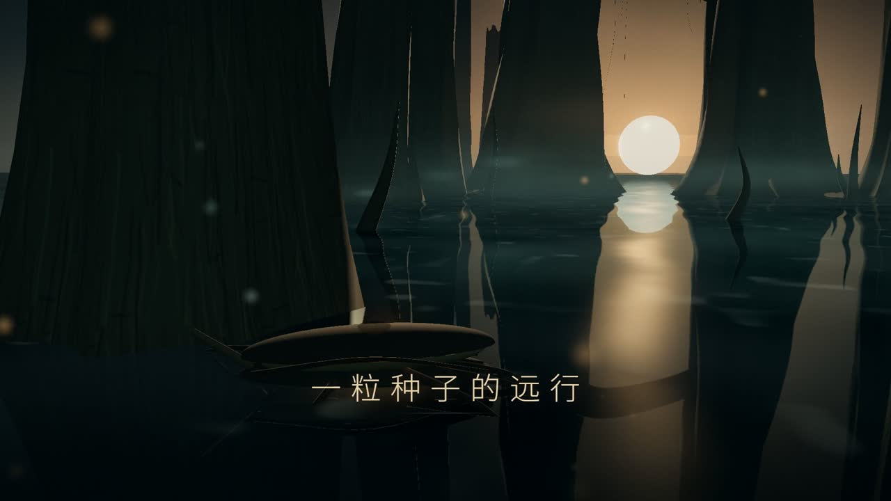

# DeepSeek Code Cinema

**用 DeepSeek Flash，把代码拍成电影短片。**

DeepSeek Code Cinema 是面向本地 AI 编程助手的创作 Skill。它把内容理解、分镜、画面与声音、Remotion 编码、真实渲染和按秒返修串起来：先设计主体做什么、结果怎样变化，再放文字和效果。面向已会使用 AI 编程工具、能处理基本开发环境的人。

## 安装与开始

下载 [完整 Skill 安装包](https://github.com/Ww-Cooooo/deepseek-code-cinema/releases/download/v1.0.0-rc.3/deepseek-code-cinema-1.0.0-rc.3.zip)，解压后将整个 `deepseek-code-cinema/` 复制到宿主的 Skill 目录，目录下应直接看到 `SKILL.md`、`references/` 和 `assets/`。也可复制仓库中的 [`skill/deepseek-code-cinema/`](skill/deepseek-code-cinema/)。已有同名包先备份，再替换完整目录，避免两版资源混用。

官方 DeepSeek Harness 的用户目录为 `~/.dsh/skills/deepseek-code-cinema/`，项目目录为 `.dsh/skills/deepseek-code-cinema/`。也可放入它支持的 `.agents/skills/`。还没有宿主时，按[固定版本安装、凭据与模型设置](docs/deepseek-harness.md)准备。选择用于存放本次作品的工作目录，在该目录开启宿主新会话，明确调用：

```text
/deepseek-code-cinema 做一支约一分钟的中文动画，解释“为什么排队时多开一个窗口不一定更快”。
面向普通观众，画面要能演示过程，配合适声音。
请完成 MP4、可修改工程和审片，给出工程目录、完整 MP4 和审片记录的路径，
并告诉我尚需人工确认什么。
```

你也可以提供脚本、参考、图片和有权使用的音乐。默认约 60 秒、横屏 1080p、30fps，可直接要求其他时长和比例。返修时提供同一工程及“第几秒、哪里、怎样改、哪些保留”。

**当前为试用版 `1.0.0-rc.3`。** 两支50秒完整片均已获用户完整观看、听音后接受，下面提供实际成片和源码。本轮官方 DeepSeek Harness 的共同开发、制作、失败、返修及安装检查，API峰价估算合计约9.83元；实际账单未知。创作执行与导出辅助范围见[验证记录](validation/README.md)，不承诺一次成功或固定费用。

## 示例作品


| 作品 | 表达任务 | 实际状态与源码 |
| --- | --- | --- |
| [《光来的方向》完整MP4](https://github.com/Ww-Cooooo/deepseek-code-cinema/releases/download/v1.0.0-rc.3/light-from-the-past-50s.mp4) | 用光的出发、穿行和抵达解释“仰望星空是在看过去” | 50.005秒有声完整片，已获用户验收；[工程说明](examples/light-from-the-past/) · [源码ZIP](https://github.com/Ww-Cooooo/deepseek-code-cinema/releases/download/v1.0.0-rc.3/light-from-the-past-source-1.0.0-rc.3.zip) |
| [《一粒种子的远行》完整MP4](https://github.com/Ww-Cooooo/deepseek-code-cinema/releases/download/v1.0.0-rc.3/seed-journey-50s.mp4) | 无旁白视觉故事，用行动、阻碍和结果推进 | 50秒有声完整v2，已获用户验收；[工程说明](examples/seed-journey/) · [源码ZIP](https://github.com/Ww-Cooooo/deepseek-code-cinema/releases/download/v1.0.0-rc.3/seed-journey-source-1.0.0-rc.3.zip) |



示例画面、音乐和音效由目标模型在各自业务工程中写代码生成；第二片补过WAV技术输出尾段，普通反馈、导出辅助和检查范围均在[验证记录](validation/README.md)说明。[本版全部资产与校验值](https://github.com/Ww-Cooooo/deepseek-code-cinema/releases/tag/v1.0.0-rc.3)集中提供安装包、两支MP4和可独立解压的工程。

## 它怎样制作

你给主题或素材，实际执行模型决定叙事、镜头、视觉风格与代码。Skill 提供可迁移的创作判断和原创起始工程，Remotion 将 React/TypeScript 画面逐帧渲染成影片。它不强制任何额外付费图片、视频或配音生成服务。

| 你要解决的问题 | 包里提供的做法 |
| --- | --- |
| 画面只是文字翻页 | 先设计主体动作、反应和结果，用路径、比较、积累、重排等表达关系，再命名和解释 |
| 场景有元素却没有空间与镜头 | 按题材选择图形/2.5D 或 Three.js 世界，用机位、遮挡、尺度、光和材质组织画面，先交代表短段核对方向 |
| 改长度后动作截断 | 统一输出规格与镜头时长、推导时间轴，用局部进度安排动作，并复查实际输出 |
| 中文缺字、读数或转场打架 | 随包中文字体；检查代表帧、关键状态和切点；数字与单位同源 |
| 有文件却没审过 | 区分帧检查、连续播放、声音检测与人工听音，交付实际检验范围 |
| 某个镜头不满意 | 按秒定位并局部改工程，保留认可部分和旧版，再导出新 MP4 |

题材可以是知识机制、产品流程或故事。镜头、配色、材质与节奏要随内容设计，起始工程不是换字模板；效果仍依赖执行模型的创作、实现和审片能力。

## 运行条件

需要支持 Skill、本地文件/命令与图像读取的 Agent，Node.js 22.19+ 或 24+、npm 及 Chromium 浏览器。主测 Windows / PowerShell 7；其他系统尚未实测。Windows 官方 Harness 还需允许打包器与浏览器子进程，受限沙箱的实际限制见[宿主说明](docs/deepseek-harness.md)。将执行模型设为你要用的型号，复制 Skill 不会替你切换模型或提供 API 额度。

当前目标基线是官方 `@deepseek-ai/dsh@0.2.1-rc.2`。`deepseek-flash` 在 2026-10-19 的官方映射为 DeepSeek-V4.1-Flash-1017；模型别名会更新。[官方说明](https://api-docs.deepseek.com/zh-cn/news/news261017/)和本包的实际独立执行证据分别核对，不能仅凭宿主声明就称验证成功。其他支持 SKILL.md 的助手可参考自身安装规则，未逐一验证。

首次依赖安装和浏览器准备可能联网；能用现有浏览器就复用，不指定私人路径或统一 npm 镜像。工程字体及其 OFL 许可随包提供。模型调用按服务自身收费，本项目没有“固定几毛钱一遍成功”的承诺。

想先检查工具，将仓库的 [`skill/deepseek-code-cinema/assets/starter/`](skill/deepseek-code-cinema/assets/starter/)（安装包中为 `deepseek-code-cinema/assets/starter/`）完整复制到一个新工程目录，并在该工程目录运行：

```text
node scripts/doctor.mjs
npm ci
npm run typecheck
npm run sound
npm run render -- --out out/starter-v1.mp4
```

这会生成六秒原创几何小样。预览用 `npm run studio`；出片和局部检查的完整命令见 [运行说明](skill/deepseek-code-cinema/references/runtime.md)。

## 画面、声音与数据边界

渲染在本地完成；宿主模型可能把任务文字、代码和主动读取的帧发送给模型服务，按你选择的宿主与服务政策处理。不要把客户资料、密钥或无权使用的素材加入工程。Skill 不提供自动发布、账号操作或额外付费素材授权。

声音可来自有权使用的素材、许可清楚的免费音源或适合题材的原创制作。包里的简易合成器只帮助制作某些风格的短音/程序配乐；有音轨不等于听感合格。模型无法实际听音时，应把整片交给人工并标明待验收。

## 源码与许可

- [`skill/deepseek-code-cinema/`](skill/deepseek-code-cinema/) 是可独立复制的完整 Skill。
- [`assets/starter/`](skill/deepseek-code-cinema/assets/starter/) 含原创起始工程、锁文件、字体和声音入口。
- [`validation/`](validation/) 说明实际执行配置、检查范围与未完成项。

本项目原创部分采用 [MIT](LICENSE)。字体保持 SIL OFL；Remotion 采用自身许可，使用者需按其组织和用途核对条件。方法参考归属、第三方版本与许可入口见 [SOURCES.md](SOURCES.md)。本包没有再分发参考影片的原始代码、画面或音乐。
